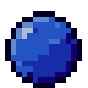

# MSM Examples

One commented example of every kind of thing MSM makes, in one project: open it to see how each kind is filled in.

- **Category:** Every kind
- **Made for:** Minecraft 26.3 (MSM target `mc-26.3`)
- **Made by:** the MCSuperMods library (an example that ships with the app)
- **Licence:** MIT, like MCSuperMods

## What is in it (118 examples)

- **Block model:** A full-cube block model with one texture on every side.
- **Blockstate with rotation:** A pillar blockstate that turns one model to follow the axis property.
- **Item definition by display context:** An item that looks different in inventories than in the hand.
- **Language file:** English names for your content, and a renamed vanilla item.
- **Sound events:** A new sound event that plays vanilla sound files at random.
- **Pack metadata:** The pack.mcmeta description shown in the pack lists.
- **Worn armour look:** An equipment asset: how armour of one material looks on a player.
- **Atlas source:** Adds a texture from a folder of its own to the block atlas, so block models can use it.
- **Icon font:** A font with one icon glyph drawn from a texture, for use in chat and signs.
- **Blue flame:** Gives vanilla's flame particle a blue picture of the project's own, in a plain resource pack.
- **Shaped recipe with a named result:** A crafting recipe whose result carries a custom name and lore.
- **Chest loot table:** A treasure table with weighted entries and a rare bonus roll.
- **Advancement tab:** A root advancement with its own tab and a child that rewards experience.
- **Stormy night predicate:** A condition that is true during a thunderstorm or at night.
- **Name and lore modifier:** Renames the held item and adds a lore line.
- **Function with execute:** A function that uses scores and execute to react to the player.
- **Block tag:** A group of blocks, used in commands, predicates and other tags.
- **Item tag:** A group of items, used as a recipe ingredient or in item predicates.
- **Entity type tag:** A group of mobs, used in target selectors and entity predicates.
- **Fluid tag:** A group of fluids, used in location predicates.
- **Game event tag:** A group of game events, such as those a sculk sensor can hear.
- **Function tag:** A group of functions run together with /function #<tag>.
- **Damage type tag:** A group of damage types, used in damage predicates and enchantments.
- **Enchantment tag:** A group of enchantments, used for exclusivity and enchanting tables.
- **Painting variant tag:** A group of painting variants; minecraft:placeable lists those a placed painting can pick.
- **Biome tag:** A group of biomes, used to decide where structures generate.
- **Structure tag:** A group of structures, used by /locate, maps and explorer trades.
- **World preset tag:** A group of world presets; minecraft:normal lists the World Type choices.
- **Villager trade tag:** A group of villager trades; vanilla villagers draw theirs from tags such as minecraft:fletcher/level_1.
- **Banner pattern tag:** A group of banner patterns, such as those a banner pattern item unlocks in the loom.
- **Dialog tag:** A group of dialogs; vanilla tags put dialogs on the pause screen and the quick actions key.
- **Instrument tag:** A group of goat horn calls, used by goats and by loot that hands out horns.
- **Point of interest tag:** A group of point of interest types, the job sites, beds and nests villagers and bees look for.
- **Potion tag:** A group of potions, used by brewing recipes and by the trader potion list.
- **Timeline tag:** A group of timelines; a dimension type runs the timelines of its tag.
- **Feature tag:** A group of configured features, such as the flowers bone meal can grow.
- **Superflat preset tag:** A group of superflat presets; minecraft:visible lists those on the Presets screen.
- **Damage enchantment:** A sword enchantment that adds damage per level.
- **Damage type:** A new kind of damage with its own death message key.
- **Dimension type:** The settings of a bright, short world: sky, light and height.
- **Chat type:** A gold chat format for announcements.
- **Jukebox song:** A new jukebox song that plays the cat disc track.
- **Banner pattern:** A banner pattern entry that reuses a vanilla pattern texture.
- **Painting:** A one-block painting with its own placeholder picture.
- **Trim material:** An armour trim material that reuses the quartz colour palette.
- **Trim pattern:** An armour trim pattern that reuses the coast design.
- **Notice dialog:** A welcome screen with a message and an OK button, opened from a function.
- **Villager trade:** A fletcher trade selling spectral arrows for emeralds, offered to apprentice fletchers through their trade tag.
- **Trade set:** Draws three different trades from a villager trade tag.
- **Snowy wolf skin:** A frost-white wolf skin, tame and angry looks and baby textures included, for snowy taigas and groves.
- **Cat variant:** A ruby-red cat skin that stray cats can have anywhere.
- **Pig variant:** A pink-violet pig skin for cherry groves.
- **Cow variant:** An amber cow skin for meadows.
- **Chicken variant:** A jade-green chicken skin for flower forests.
- **Frog variant:** A sapphire frog skin for mangrove swamps.
- **Zombie nautilus variant:** A slate-grey zombie nautilus skin that can appear in any ocean.
- **Cat sound variant:** A cat that purrs like the royal cat but meows like the classic one.
- **Pig sound variant:** A pig that grunts like the big pig and squeals like the mini one when hurt.
- **Cow sound variant:** A cow that moos like the moody cow but steps like the classic one.
- **Chicken sound variant:** A chicken that clucks like the picky chicken.
- **Custom goat horn:** A goat horn with its own call, length and range, crafted from a goat horn and an echo shard, that goats can drop.
- **Trial spawner wave:** A trial spawner configuration that sends husks and baby zombies, with its own rewards.
- **Enchantment provider:** A rule that enchants gear like a level 5 to 20 enchanting table.
- **Timeline: slime moons:** A timeline that doubles the surface slime chance every other day, added to the overworld timelines.
- **World clock:** A clock of its own that timelines and dimension types can follow.
- **Pot pattern:** A fish picture for the sides of decorated pots, drawn on fired clay.
- **Block transformer:** A rule that turns coarse dirt into a dirt path, as a shovel flattens grass.
- **Test environment:** Rainy weather on hard difficulty, for game tests that name it.
- **Test instance:** A game test that places a structure and waits for a test block to pass.
- **Sulfur cube kind:** A sulfur cube that turns hot when fed magma cream.
- **Whole-number provider:** A named whole number the game can read: a random value from 2 to 4.
- **Decimal-number provider:** A named decimal number the game can read: always one and a half.
- **Screen effect:** A warm sepia tint over the whole screen, from the vanilla copy shader.
- **Waypoint style:** A locator bar dot that shrinks over a long way.
- **Shader program:** A shader program definition naming the vanilla textured shaders.
- **Structure template:** A small stone well, stored as JSON and exported as a structure .nbt file.
- **Template pool:** A pool that picks a flower bed or nothing, as jigsaw blocks do.
- **Jigsaw structure:** A lone tower in mountains and hills, built from one template.
- **Structure set:** Places a small ruin across taiga biomes, spread out with random_spread.
- **Processor list:** Cracks and moss stone bricks and leaves a few blocks out, for an old look.
- **Biome:** A quiet meadow: no trees, flowers and grass, the usual ores and caves.
- **Configured feature:** Clay pockets in dirt: an ore feature that replaces dirt with clay.
- **Placed feature:** Scatters poppies in patches on the surface.
- **Dimension:** A new dimension where the whole world is a cherry grove.
- **World preset:** A World Type with amplified terrain covered in cherry groves.
- **Noise settings:** Gentle hills from a height gradient plus one noise, with a simple surface.
- **Density function:** A reusable density function: one vanilla noise, stretched horizontally.
- **Noise:** Noise parameters: three octaves starting at a large scale.
- **Carver:** Wide cave tunnels between the bottom of the world and y 180.
- **Superflat preset:** A superflat preset: bedrock, stone, dirt and grass in the plains biome.
- **Multi-noise parameter list:** A named biome layout using the vanilla overworld parameters.
- **Block state provider:** Picks stone, andesite or cobblestone by weight.
- **Material condition:** True at and above y 63; a building block of surface rules.
- **Material rule:** A surface rule: bedrock at the bottom, grass over dirt on top.
- **Switch lamp:** A custom block that lights up when used or powered by redstone, by swapping itself for a lit twin.
- **Sparkle berries:** A custom food item that sparkles and chimes when you start eating it.
- **Frost bomb:** A custom Frostbite effect that slows and chills its holder, and a throwable Frost Bomb that gives it to the mob it hits.
- **Potion of the custom effect:** A custom Featherweight effect and its potion, brewed from an awkward potion and a feather, with a longer version and splash and lingering bottles.
- **Mod metadata:** The name, version, authors and licence of the Fabric mod jar.
- **Ore that generates:** Jade ore that generates underground in every overworld biome: the ore block, its ore feature, the placed feature and the world addition that adds it to vanilla biomes.
- **Zombie drops a ruby:** Zombies killed by a player sometimes drop a ruby, on top of their usual drops: a ruby item and the extra drop that adds it to the vanilla zombie loot table.
- **Drifting ember:** A particle type of its own: a small amber spark that twinkles, glows in the dark, floats up and fades out. Try it with /particle.
- **Wandering creature:** A peaceful mob that strolls about, looks at players and has a spawn egg, with its model, animations and textures.
- **Cube creature model:** A box-shaped GeckoLib model with a body and a head bone over a 64x64 texture, shown on a small mob.
- **Idle and walk animations:** An idle bob and a walk cycle that swings the arms and legs of a biped model, shown on a small mob.
- **Script: block interaction:** A script that cancels using a lodestone with an empty hand and gives the player a compass instead.
- **Rules: a lucky block:** A lucky block and a lucky coin made with rules, no code: breaking the block is a gamble between a few coins and a silverfish, a counter keeps score, and spending a coin gives Luck.
- **Vehicles: a tank battle:** A drivable tank with a turret that follows your view, a cannon, a shell crate and a reload line on the screen.
- **Controls: a dash ability:** A key (Z by default, shown in Controls) that dashes the player forward once a second, with a charge bar on screen.
- **Controls: a score and a mana bar:** Two HUD elements: a mana bar above the hotbar and a score line in the top-right corner, both read from the game.
- **Command: /welcome:** A server command anyone can type, /welcome (or /hi), that plays a chime and answers in chat, with no function.
- **Creative tab: Curios:** A tab of its own in the creative inventory with a curio block in it, listed by name.
- **Villager look: Blossom villagers:** Villagers born or spawned in cherry groves wear pink clothes with a cream hem and sash, and so do zombie villagers there.
- **Game rule: Sparkle trails:** A world setting of your own, on in a new world, that a rule reads to decide whether sneaking players leave sparkles; switch it off with /gamerule.
- **Statistic: Bells rung:** A count of your own in the Statistics screen: how many times each player has rung a bell, kept by a rule.
- **Village blacksmith job:** A blacksmith job for villagers: a villager takes it at a forge block, wears a leather apron and trades coal, iron and a toolsmith's wares as it levels up.
- **Oil well:** Oil: a thick dark liquid that flows slowly and never refills, slows down whoever wades in, comes in a bucket and lies in lakes in deserts.
- **Rules for vanilla blocks:** An axe scrapes the moss off mossy cobblestone and stone bricks, a shovel packs mud, a hoe turns a moss block into dirt, and huge mushroom blocks catch fire, all for vanilla blocks.

## How to open it

1. Download this folder (or the whole repository as a zip from the green **Code** button).
2. In MCSuperMods, choose **File > Open Project…** and pick this folder (the one with `msm.project.json` in it).
3. Look around, change things, then use **Play** or **Export** to try it in the game.

For another Minecraft version, use **File > Upgrade Project Target…** in MCSuperMods. The checks of this repository open the example on mc-26.4 (Minecraft 26.4-snapshot-7) that way too.

This folder is made from the MCSuperMods `examples/` folder by `tools/community-repo/sync.ts`; change the example there, not here.
