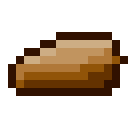

# MSM Blocks and Items Examples

Blocks and items that do something: tools with recipes, event chains, fuel, effects while worn, potions, particles, portals and the vanilla-style furniture, plants and copper.

- **Category:** Blocks and items
- **Made for:** Minecraft 26.3 (MSM target `mc-26.3`)
- **Made by:** the MCSuperMods library (an example that ships with the app)
- **Licence:** MIT, like MCSuperMods

## What is in it (33 examples)

- **Sturdy pickaxe:** A custom iron-tier pickaxe with extra durability and a crafting recipe.
- **Beacon stone:** A block whose use event triggers a second event that spawns particles and runs a function.
- **Fuel log:** A dense log block whose item burns in a furnace three times as long as an oak log.
- **Life-steal sword:** An iron sword that heals you by one heart each time it hits a mob.
- **Night-vision helmet:** An iron helmet that gives night vision while you wear it.
- **Brewed with your own item:** A Moon Shard item of your own as a brewing ingredient: an awkward potion and a moon shard brew a Potion of Levitation, which vanilla does not have, with a stronger version.
- **Elm wood set:** A whole wood set from the Wood set flow: logs, planks, stairs, slab, fence, gate, door, trapdoor, button, plate, foliage-tinted leaves and a sapling that grows an elm tree.
- **Shale stone set:** Every member of the Stone set flow: the stone, its stairs, slab and wall, a button and pressure plate, polished shale with its own shapes, bricks and a pillar, crafted and stonecut.
- **Onion crop:** A crop planted from its produce, as carrots: onions grow through eight stages, are eaten raw and grow wild on grass in forests.
- **Silver birch tree:** A sapling that grows a tall branching tree of vanilla birch logs and new silver leaves, and grows in forests.
- **Crusher:** A machine-like block that turns its front towards you when placed, as a furnace does.
- **Vault door:** A two-block-high metal door that opens only with a redstone signal, as an iron door, with a stone button to open it.
- **Ember vines with glowing berries:** Vines that hang from cave ceilings and bear glowing berries you pick and eat, as cave vines, from the Cave plants flow.
- **Sea ribbon:** A water plant that grows up from the sea floor a block at a time, as kelp, from the Cave plants flow.
- **Glow moss:** A thin moss that covers any side of a block, glows softly and spreads with bone meal, as glow lichen, from the Cave plants flow.
- **Dune reed:** A reed that grows tall by water on sand and grass and makes sugar, as sugar cane, from the Desert plants flow.
- **Spine cactus:** A tall spiny cactus that grows twice as high as vanilla cactus, hurts what touches it and smelts into green dye, from the Desert plants flow.
- **Reed bamboo:** A woody stalk that grows from a shoot, carries leaves near its top and makes sticks, as bamboo, from the Desert plants flow.
- **Wide leaf:** A big leaf on a stem that tips under you, and a small one that bone meal grows into it, as big and small dripleaf, from the Desert plants flow.
- **Clay planter:** A flower pot of its own that takes six vanilla flowers and saplings, crafted from clay, from the Flower pot flow.
- **Bronze fittings that age:** A rod, a button, a pressure plate, a fence, a gate, a wall and a chest that joins into a double chest, all of a bronze that turns green as copper does, with waxed copies, from the Copper set flow. Lightning scrapes them back.
- **Loot crate in a structure:** A stone crate with a chest screen, placed in a small room by a structure template that gives it a loot table, so it fills on the first open as a dungeon chest does.
- **Ore crusher:** A machine from the Machine flow that crushes raw iron, gold and copper into two ingots each, burning fuel, with a hopper chain that feeds it and empties it into a chest.
- **Shulker crate:** A crate that keeps its 27 slots of items when broken and carries them in its item, as a shulker box does, from the Storage crate flow.
- **Twin crate:** A wooden crate that joins a crate beside it into one double chest of 54 slots, as vanilla chests do, from the Storage crate flow.
- **Private crate:** A stone crate in which every player finds their own items, as an ender chest, from the Storage crate flow.
- **Two-way sky portal:** A portal from the Portal flow to a flat sky dimension and back, in a frame of its own block, lit with flint and steel or by using a beacon block (light_portal), with blue dust and an on_travel function that says a line.
- **Firefly jar:** A glowing firefly particle of its own, a glass jar that shows it by itself (ambient particles) and a spark wand that sends a burst of fireflies upwards (motion) with a cloud of coloured dust (an options object).
- **Cottage furniture and lights:** A straw bed, a lantern, a torch, a standing and a hanging sign, a potted plant, a rug and a cupboard that holds items: the new furniture block types in one project.
- **Orchard and pie:** A berry bush that ripens in four stages and gives its own berries, a tall flower two blocks high and a pie that you eat slice by slice, crafted from the berries.
- **Copper roof:** Roof stairs and slabs that age through four stages like copper, from bright to green, and waxed copies that keep their colour: waxing with honeycomb and scraping with an axe.
- **Adventurer's satchel:** A satchel that holds two rows of items, a roll that works like a bundle and a creative tab of their own, with the recipes that make them.
- **Berry juice:** A pink juice you pour into cauldrons and scoop into bottles that feed and heal you, which sets into pink terracotta where lava touches it.

## How to open it

1. Download this folder (or the whole repository as a zip from the green **Code** button).
2. In MCSuperMods, choose **File > Open Project…** and pick this folder (the one with `msm.project.json` in it).
3. Look around, change things, then use **Play** or **Export** to try it in the game.

For another Minecraft version, use **File > Upgrade Project Target…** in MCSuperMods. The checks of this repository open the example on mc-26.4 (Minecraft 26.4-snapshot-7) that way too.

This folder is made from the MCSuperMods `examples/` folder by `tools/community-repo/sync.ts`; change the example there, not here.
