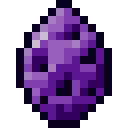

# MSM Entity Examples

Mobs with their own models, animations, skins and spawn eggs: one that attacks players and one that spawns in the wild.

- **Category:** Mobs
- **Made for:** Minecraft 26.3 (MSM target `mc-26.3`)
- **Made by:** the MCSuperMods library (an example that ships with the app)
- **Licence:** MIT, like MCSuperMods

## What is in it (13 examples)

- **Hostile mob:** A monster that chases and hits players, fights back when hurt and spawns in the dark.
- **Natural spawning:** A creature that spawns on its own in forests and plains, using a biome tag and a biome id.
- **Tameable fox-like pet:** A fox-like animal you tame with sweet berries: it sits when told, follows and defends you, has babies and grows a white coat in snowy biomes.
- **Rideable flying mount:** A big round flyer you saddle and ride through the air: it flies where you look and rises while you hold jump.
- **Archer with a throwable:** A skeleton-like monster that circles players and throws ice shards, a project item with msm:throwable, from a distance.
- **Fish school with biome variants:** A fish that swims in schools in every ocean, orange in warm oceans and pale in cold ones, and flops and dries out on land.
- **Boss with a boss bar:** A giant monster with a red boss bar that darkens the sky and fogs the world, summoned only from its spawn egg.
- **Drawn without GeckoLib:** A small creature drawn by the runtime's own renderer, never GeckoLib, so it needs no GeckoLib on any target.
- **Minnow you catch in a bucket:** A little river fish you catch with a water bucket and let out again, which plays dead when badly hurt.
- **Hovering wisp that roosts:** A gentle wisp that floats four blocks above the ground at night and hangs under a block through the day, as a bat.
- **Finch that fetches and rides your shoulder:** A small bird you tame with seeds: give it an item and it brings you more of the same, and it rides on your left shoulder, leaving the right one for another pet.
- **Fair trader who remembers you:** A travelling trader whose prices drop for players who trade with it or bring it flowers and rise for those who hit it, who restocks at a barrel and barters for gold.
- **Roadside merchant:** A merchant by the road who sells bread and apples, then saddles and leads once you have traded with it, and rings a bell with every sale.

## How to open it

1. Download this folder (or the whole repository as a zip from the green **Code** button).
2. In MCSuperMods, choose **File > Open Project…** and pick this folder (the one with `msm.project.json` in it).
3. Look around, change things, then use **Play** or **Export** to try it in the game.

For another Minecraft version, use **File > Upgrade Project Target…** in MCSuperMods. The checks of this repository open the example on mc-26.4 (Minecraft 26.4-snapshot-7) that way too.

This folder is made from the MCSuperMods `examples/` folder by `tools/community-repo/sync.ts`; change the example there, not here.
