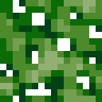

# Empty sky with a start island

A World Type of empty sky, for a Skyblock: the biome of the sky. The start island, its chest and what you start with come from the Skyblock flow; until MSM has it, this makes the empty world only. Choose it under More > World Type when creating a world.

- **Category:** Starters
- **Made for:** Minecraft 26.3 (MSM target `mc-26.3`)
- **Made by:** the MCSuperMods library (an example that ships with the app)
- **Licence:** MIT, like MCSuperMods

## How to open it

1. Download this folder (or the whole repository as a zip from the green **Code** button).
2. In MCSuperMods, choose **File > Open Project…** and pick this folder (the one with `msm.project.json` in it).
3. Look around, change things, then use **Play** or **Export** to try it in the game.

For another Minecraft version, use **File > Upgrade Project Target…** in MCSuperMods. The checks of this repository open the example on mc-26.4 (Minecraft 26.4-snapshot-7) that way too.

This folder is made from the MCSuperMods `examples/` folder by `tools/community-repo/sync.ts`; change the example there, not here.
